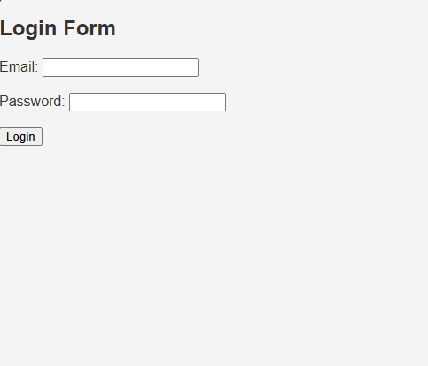

React LoginForm:-
1. Project Overview:
This project is a simple Login Form built using React and the useState Hook. It allows users to enter their email address and password, validates the input, and displays error or success messages based on the validation results.

2. Features:
Email Validation: Checks whether the email contains the @ symbol.
Password Validation: Ensures the password contains at least 6 characters.
Error Messages: Displays an error message when the entered information is invalid.
Success Message: Displays "Login successful!" when both validation checks pass.
State Management: Uses React's useState Hook to manage email, password, error, and success states.
Controlled Inputs: Uses React state to control the values of the email and password fields.
Form Submission: Uses handleSubmit to process the form without refreshing the page.

3. Technologies Used:
React
JavaScript (ES6+)
JSX
HTML

4. file path:
PS C:\Users\Srinivasa Rao\Desktop\NYB\NYB Programs\React\Reactpractice\LoginForm

5. Loginform image
### Login Form

//practical assignment
# React Employee Management System

## Overview
A simple employee management application built using React.

## Features
- Login and protected routes
- Dashboard and employee details
- Add, edit and delete employees
- Search and department filtering
- Context API and useReducer
- Custom Hook
- React.memo and useMemo
- Lazy-loaded pages
- API loading and error handling
- Error Boundary
- Component and interaction tests

## Technologies
- React
- Vite
- React Router
- Context API
- useReducer
- React Testing Library
- Vitest

## Installation
npm install
npm run dev

## Testing
npm run test:run

## Production Build
npm run build

## Demo Login
Username: admin
Password: 1234

Note: Demo credentials are hardcoded for learning only.
The application uses client-side state and a public demo API.
